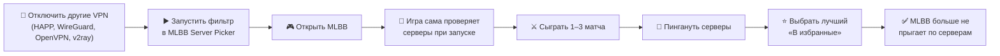
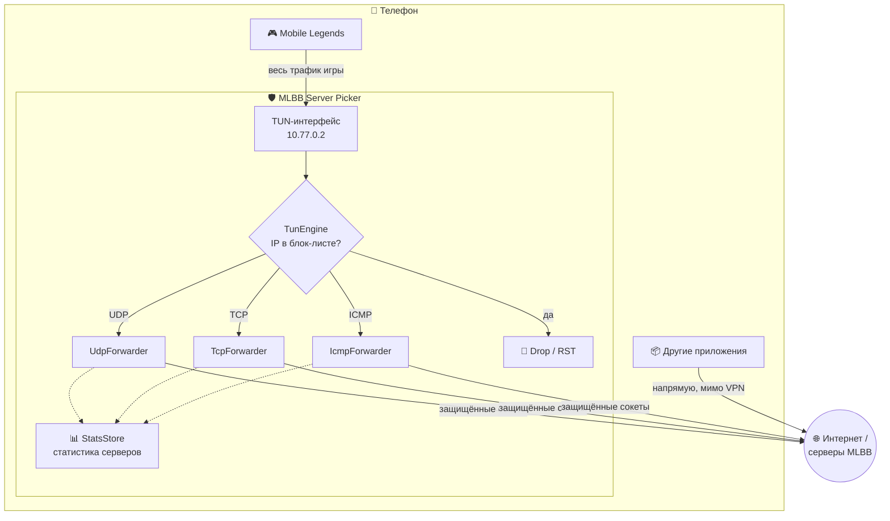

<div align="center">


# 🛡️ MLBB Server Picker

**Локальный фильтр серверов для Mobile Legends: Bang Bang**
Выберите игровой сервер с хорошим пингом и закрепите его, чтобы игра не переключалась между серверами сама.

<br>

[](https://github.com/levoe123/MlbbServerPicker/releases/latest)
[](https://www.donationalerts.com/r/levoe123)
[](https://t.me/levoe123)

<br>


</div>


---

## 📑 Содержание

- [⚠️ Важно прочитать перед использованием](#️-важно-прочитать-перед-использованием)
- [✨ Возможности](#-возможности)
- [📲 Установка](#-установка)
- [🚀 Как пользоваться](#-как-пользоваться)
- [⚙️ Как это работает](#️-как-это-работает)
- [🔍 Как определяются серверы](#-как-определяются-серверы)
- [🔒 Приватность](#-приватность)
- [🛠️ Настройки](#️-настройки)
- [❓ FAQ / решение проблем](#-faq--решение-проблем)
- [🏗️ Сборка из исходников](#️-сборка-из-исходников)
- [❤️ Поддержать автора](#️-поддержать-автора)

---

## ⚠️ Важно прочитать перед использованием

> [!WARNING]
> ### 🧨 Массовое использование вредит всем игрокам
>
> Система подбора матчей в MLBB распределяет игроков по серверам с помощью **балансировщиков нагрузки** — аппаратных (сами серверы) и сетевых (маршрутизация, каналы связи). Игра проверяет несколько серверов-кандидатов и учитывает их загрузку.
>
> Приложение **прячет от игры часть серверов**. Если так будет делать один человек, это незаметно. Если много людей:
>
> - нагрузка соберётся на нескольких «популярных» серверах, и балансировщики **не смогут её распределить**;
> - эти серверы перегрузятся, и у всех вырастут **пинг, джиттер, потери пакетов и время поиска матча**;
> - пул игроков на выбранных серверах уменьшится, и **подбор соперников станет хуже**;
> - в итоге это может сказаться на **производительности серверов и игры в целом**.
>
> 📉 **Сегодня пинг может стать (и скорее всего станет) ниже, но в будущем это не даст выигрыша.** Когда так поступают все, «лучший» сервер перестаёт быть лучшим.
>
> 🙏 Пользуйтесь разумно: для диагностики, когда сервер действительно плохой, а не постоянно «на всякий случай».

> [!IMPORTANT]
> ### 🛡️ Это не чит
>
> - Приложение — **локальный фаервол на телефоне**, сделанный через стандартный Android `VpnService`.
> - **Клиент игры не модифицируется**: файлы, память и протокол игры не меняются, в игру ничего не внедряется.
> - Приложение только **не пропускает пакеты** к выбранным IP-адресам. Для игры это выглядит так, будто сервер недоступен.
> - Точно такую же картину может создать **провайдер связи**: недоступный узел, сбой маршрута, фильтрация. Доказать со стороны MLBB, что использовался именно этот VPN, непросто.
>
> ⚖️ Но всё равно: **используйте на свой страх и риск.** Автор не несёт ответственности за последствия, включая возможные санкции со стороны разработчиков игры. Правила игры могут измениться в любой момент.
>
> 🔁 И ещё раз: **приложение негативно влияет на матчмейкинг**, особенно при массовом использовании.

> [!CAUTION]
> ### 🚫 Одновременно работает только один VPN
>
> Android разрешает только **одно** активное VPN-подключение. Приложение работает через **локальный перехват трафика**, поэтому перед игрой нужно **отключить все другие VPN и прокси**:
>
> `HAPP` · `WireGuard` · `OpenVPN` · `v2ray / v2rayNG` · `Clash` · `Outline` · `AmneziaVPN` и т. п.
>
> Также выключите **«Постоянная VPN» (Always-on VPN)** в настройках Android для других приложений. Если другой VPN включится, система отключит фильтр.

---

## ✨ Возможности

| | |
|---|---|
| 🎯 **Автоопределение серверов** | Игровые серверы, серверы-пробы и лобби находятся автоматически по трафику игры |
| 📶 **Два вида пинга** | Честный **игровой пинг** (по пробам самой игры) и отдельный **ICMP-пинг** |
| ⭐ **Избранное** | Закрепите один или несколько серверов, остальные игровые будут заблокированы |
| 🤖 **Авто-блокировка** | Режим «только избранные»: новые игровые серверы блокируются сразу при появлении |
| ⏳ **Блок после матча** | Если на сервере идёт бой, блокировка применится после матча, и вас не выкинет |
| 🌍 **Гео и провайдер** | Страна, город, провайдер и ASN каждого сервера |
| 🔁 **Авто-пинг избранного** | По одному серверу с паузами, чтобы замеры не мешали друг другу |
| 🧭 **Фильтры и сортировка** | Игровые / сейчас / заблокированные / прочие; сортировка по пингу, игровому пингу или активности |
| 🏷️ **Метки** | Подписи к серверам («мой лучший», «лагает вечером») |
| 📤 **Экспорт CSV** | Вся статистика по серверам в таблицу |
| 🌐 **RU / EN** | Русский и английский интерфейс |
| 🌙 **Тёмная тема** | Material 3, edge-to-edge |
| 🚫 **Без рекламы и трекеров** | Совсем |

---

## 📲 Установка

1. Скачайте APK из [**Releases**](https://github.com/woksonal/MLBB-Server-Picker/releases/latest).
2. Разрешите установку из неизвестных источников, если Android спросит.
3. Установите и откройте приложение.

**Требования:**

- Android **7.0+** (API 24);
- процессор **ARM / ARM64** (`android-arm`, `android-arm64`), то есть практически любой современный телефон;
- установленная Mobile Legends. Поддерживаемые пакеты по умолчанию:
  - `com.mobile.legends` — Google Play;
  - `com.mobilelegends.hwag` — Huawei AppGallery;
  - `com.mobilelegends.mi` — Xiaomi GetApps.

> Если игра установлена из другого магазина, добавьте имя её пакета в **Настройки → Пакеты игры**.

---

## 🚀 Как пользоваться

> [!TIP]
> **Порядок важен:** ① сначала включаем программу → ② потом запускаем MLBB → ③ затем выбираем серверы.



### Пошагово

**1. Отключите другие VPN.** Иначе фильтр не запустится или его отключит система.

**2. Запустите фильтр.** На вкладке **«Статус»** нажмите **«Запустить»** и разрешите создание VPN-подключения. В шторке появится уведомление «MLBB фильтр серверов активен».

**3. Откройте Mobile Legends.** При запуске и перед подбором игра **сама проверяет доступные серверы**: шлёт пробные пакеты и измеряет задержку. Приложение видит эти проверки и заносит серверы в список вместе с честным игровым пингом.

**4. Сыграйте 1–3 матча.** Вкладка **«Серверы»** заполнится игровыми серверами со страной, провайдером и пингом.

**5. Пинганите серверы.** Нажмите кнопку 📶 на вкладке «Серверы». Серверы пингуются **строго по одному**, с паузами, поэтому массовый пинг не искажает результаты. Список отсортируется от лучшего к худшему.

**6. Закрепите сервер.** На карточке лучшего сервера нажмите **«★ В избранные»** (или кнопку в блоке «Лучший по пингу сейчас» на вкладке «Статус»). Что произойдёт:
- сервер станет избранным;
- остальные игровые серверы будут заблокированы;
- включится **авто-блокировка**: новые игровые серверы будут блокироваться сразу;
- серверы **лобби и сервисные не трогаются**, без них игра не войдёт в аккаунт.

Теперь MLBB не сможет перескакивать на другие серверы: для неё они выглядят недоступными.

**7. Если что-то пошло не так**, нажмите **«Снять все блокировки»**, и всё вернётся как было.

### Вкладки

| Вкладка | Что там |
|---|---|
| 🛡️ **Статус** | Вкл/выкл фильтра, текущий матч, лучший сервер / избранные, переключатель авто-блокировки, счётчики |
| ⭐ **Избранное** | Ваши закреплённые серверы с авто-пингом (интервал 5–60 с) |
| 📋 **Серверы** | Все найденные серверы: фильтры, сортировка, пинг, блокировка, подробности |

### Цвета пинга

🟢 до 60 мс · 🟡 до 120 мс · 🔴 выше

---

## ⚙️ Как это работает

Приложение поднимает **локальный VPN-интерфейс (TUN)**. Это не внешний VPN-сервер: трафик **никуда не уходит**, кроме того места, куда его и так отправляла игра.

- В туннель попадает **только трафик Mobile Legends** (`AddAllowedApplication`). Все остальные приложения работают напрямую, как обычно.
- Внутри приложения работает собственный userspace-стек: UDP NAT, упрощённый TCP-прокси и проброс ICMP. Каждое соединение игры открывается заново через **защищённый сокет** (`VpnService.protect`) напрямую к настоящему серверу.
- Пакеты к **заблокированным** IP не пропускаются:
  - **UDP / ICMP** — тишина, как будто сервер выключен;
  - **TCP** — ответ `RST` (можно отключить в настройках), чтобы игра быстрее «забыла» сервер.



### Почему это не «ускоритель»

Приложение **не ускоряет интернет** и **не меняет регион** аккаунта. Оно лишь убирает из выбора игры серверы с плохим пингом, чтобы она подключалась к хорошим. Если хороших серверов поблизости нет, чуда не будет.

---

## 🔍 Как определяются серверы

Серверы находятся **автоматически** по портам и поведению трафика игры. Никаких заранее зашитых списков IP нет.

| Роль | Как определяется | Порты по умолчанию | Можно блокировать? |
|---|---|---|---|
| ⚔️ **МАТЧ** | Длинный двунаправленный UDP-поток (≥ 300 отправленных и ≥ 100 полученных пакетов) или трафик на порты матча | UDP `5003`, `5053` | ✅ да |
| 🔎 **ПРОБА** | Серверы-кандидаты, которые игра проверяет перед подбором. Здесь измеряется **честный игровой пинг**: время между запросом пробы и ответом | UDP `30190` | ✅ да |
| 🏠 **ЛОББИ** | Аккаунт, чат, подбор | TCP `30101`, `30021`, `30220` | ❌ нет, сломается вход |
| 🧩 **СЕРВИС** | Логин, CDN, магазин, обновления, аналитика | TCP `80`/`443`, UDP `53`/`443` | ❌ бесполезно и вредно |
| ❔ **ПРОЧЕЕ** | Назначение не определено | — | ⚠️ не рекомендуется |

**Пинг измеряется двумя способами:**

- **Игровой пинг (RTT)** считается по пробам самой игры на UDP `30190`, сглаживается (EMA) и **лучше всего отражает реальный пинг в бою**.
- **ICMP-пинг** — это кнопка 📶 и авто-пинг избранного. 4 пробы с паузой 200 мс, итог — медиана; между серверами пауза, на один IP действует cooldown 3 с. Это ориентир: некоторые серверы на ICMP не отвечают, и тогда показывается только игровой пинг.

**Текущий матч** определяется по активности: если по матчевому потоку идёт трафик (последние 5 секунд), сервер помечается как **«СЕЙЧАС»**.

**Гео-данные** (страна, город, провайдер, ASN) подгружаются в фоне только для игровых серверов, лобби и избранных и кэшируются на 30 дней.

> Порты можно поменять в настройках, если игра их сменит в будущем.

---

## 🔒 Приватность

> [!NOTE]
> ✅ **Данные пользователя не собираются.**
> ✅ **Рекламы нет.**
> ✅ **Аналитики, трекеров и сторонних SDK нет.**
> ✅ **Root не нужен.**

- Вся статистика (`servers.json`) и настройки хранятся **только на вашем устройстве**, в приватной папке приложения.
- Через туннель идёт **только трафик игры**. Содержимое пакетов не анализируется и не сохраняется: считаются только адреса, порты, размеры и время.
- Единственные сетевые запросы самого приложения:
  - `ipwho.is/<IP сервера>` — определение страны и провайдера **игрового сервера** (отправляется IP сервера, а не ваш персональный идентификатор);
  - ICMP-пинг до серверов, когда вы сами его запускаете или включен авто-пинг избранного.
- Кнопка «Полный whois в браузере» просто открывает `ipinfo.io` в браузере.

---

## 🛠️ Настройки

`⋮ → Настройки`

| Параметр | По умолчанию | Описание |
|---|---|---|
| Язык | Как в системе | Русский / English |
| Интервал авто-пинга | 10 с | 5 / 10 / 15 / 30 / 60 с |
| RST для заблокированных | Вкл | Отвечать `RST` на TCP к заблокированным серверам |
| Пакеты игры | `com.mobile.legends, com.mobilelegends.hwag, com.mobilelegends.mi` | Какие приложения пускать в туннель |
| DNS в туннеле | `8.8.8.8, 1.1.1.1` | DNS для игры |
| UDP-порты проб | `30190` | Порты замера игрового пинга |
| Порты матчей | `5003, 5053` | Порты боевых серверов |
| TCP-порты лобби | `30101, 30021, 30220` | Порты лобби |

Пакеты, DNS и порты применяются **после перезапуска фильтра**.

**Другие пункты меню:** 🔋 Батарея · 🔓 Снять все блокировки · 📤 Экспорт CSV · 🧹 Очистить статистику · ❓ Как это работает · ❤️ Поддержать автора

---

## ❓ FAQ / решение проблем

<details>
<summary><b>Забанят ли меня?</b></summary>

Приложение не модифицирует игру и не вмешивается в её работу. Оно только не пропускает пакеты к отдельным IP, и такое же поведение может вызвать обычный провайдер. Но гарантий никто дать не может: **используйте на свой страх и риск.**
</details>

<details>
<summary><b>Подбор матча завис / бесконечное «переподключение»</b></summary>

Избранный сервер может быть перегружен или на обслуживании. Нажмите **«Снять все блокировки»**, сыграйте матч и выберите сервер заново.
</details>

<details>
<summary><b>Фильтр сам выключается посреди игры</b></summary>

На Xiaomi, Samsung, Huawei, Realme и других телефонах система убивает фоновые сервисы. Отключите оптимизацию батареи для приложения (`⋮ → Батарея`) и не смахивайте уведомление.
</details>

<details>
<summary><b>«Ошибка VPN» / «Система не выдала VPN-интерфейс»</b></summary>

Выключите **все другие VPN и прокси** (HAPP, WireGuard, OpenVPN, v2ray и т. д.) и «Постоянную VPN» в настройках Android.
</details>

<details>
<summary><b>Можно ли использовать вместе с другим VPN?</b></summary>

**Нет.** Android поддерживает только одно VPN-подключение, а приложение работает через локальный перехват трафика.
</details>

<details>
<summary><b>Список серверов пустой</b></summary>

Проверьте порядок: **сначала** запустить фильтр, **потом** открыть игру. Если игра уже была открыта, перезапустите её. Затем начните подбор матча.
</details>

<details>
<summary><b>ICMP-пинг «нет ответа»</b></summary>

Некоторые серверы не отвечают на ICMP. Ориентируйтесь на **игровой пинг** (значение «в игре»).
</details>

<details>
<summary><b>Пинг не изменился</b></summary>

Приложение не ускоряет интернет. Если все доступные серверы далеко, выбирать не из чего.
</details>

<details>
<summary><b>Влияет ли на другие приложения?</b></summary>

Нет. В туннель попадает только Mobile Legends, остальные приложения работают напрямую и без VPN.
</details>

---

## 🏗️ Сборка из исходников

**Требования:** .NET 10 SDK с workload `android` и Android SDK.

```bash
# установка workload (один раз)
dotnet workload install android

# клонирование
git clone https://github.com/levoe123/MlbbServerPicker.git
cd MlbbServerPicker

# сборка APK для ARM64
dotnet publish -c Release -f net10.0-android -r android-arm64 -p:AndroidPackageFormats=apk

# сборка APK для ARM (32-bit)
dotnet publish -c Release -f net10.0-android -r android-arm -p:AndroidPackageFormats=apk
```

Готовый APK появится в `bin/Release/net10.0-android/<rid>/publish/`.

### Структура проекта

```
MlbbServerPicker/
├── MainActivity.cs              # UI: вкладки, статус, список серверов
├── MainActivity.Dialogs.cs      # диалоги, настройки, справка
├── Core/
│   ├── AppSettings.cs           # настройки (SharedPreferences)
│   ├── StatsStore.cs            # статистика серверов, блок-лист, избранное
│   ├── ServerStat.cs            # модель сервера, определение роли
│   ├── Pinger.cs                # ICMP-пингер (очередь, медиана, cooldown)
│   ├── GeoResolver.cs           # страна / провайдер через ipwho.is
│   ├── Loc.cs                   # локализация RU/EN
│   └── Net.cs                   # IPv4, checksum, форматирование
├── Vpn/
│   ├── MlbbVpnService.cs        # VpnService, foreground-уведомление
│   ├── TunEngine.cs             # чтение TUN, блок-лист, диспетчер
│   ├── UdpForwarder.cs          # UDP NAT + замер игрового RTT
│   ├── TcpForwarder.cs          # userspace TCP-прокси
│   ├── IcmpForwarder.cs         # проброс ICMP через ping-сокеты
│   └── Packets.cs               # сборка IPv4/UDP/TCP/ICMP пакетов
├── UI/
│   └── ServerAdapter.cs         # карточки серверов
└── Resources/                   # разметка, строки RU/EN, иконки
```

### Разрешения

| Разрешение | Зачем |
|---|---|
| `BIND_VPN_SERVICE` | Локальный перехват трафика игры |
| `INTERNET` | Проброс трафика игры, гео-запросы, пинг |
| `FOREGROUND_SERVICE` / `FOREGROUND_SERVICE_SYSTEM_EXEMPTED` | Фильтр работает в фоне во время игры |
| `POST_NOTIFICATIONS` | Уведомление о статусе фильтра (Android 13+) |
| `REQUEST_IGNORE_BATTERY_OPTIMIZATIONS` | Чтобы система не убивала фильтр |

---

## ❤️ Поддержать автора

Приложение **бесплатное и без рекламы**. Если оно помогло вам получить хороший пинг, можно сказать спасибо донатом 🙌

<div align="center">

[](https://www.donationalerts.com/r/levoe123)
[](https://t.me/levoe123)

**Вопросы, баги, предложения:** [@levoe123](https://t.me/levoe123)

💡 Идея: стример **Сметана** — [t.me/smetana_mlbb](https://t.me/smetana_mlbb)

</div>

---

<div align="center">
<sub>

⚠️ Проект не связан с Moonton и Mobile Legends: Bang Bang. Все торговые марки принадлежат их владельцам.
Программа предоставляется «как есть», без каких-либо гарантий. **Используйте на свой страх и риск.**
Помните: массовое использование ухудшает матчмейкинг для всех игроков.

</sub>
</div>
